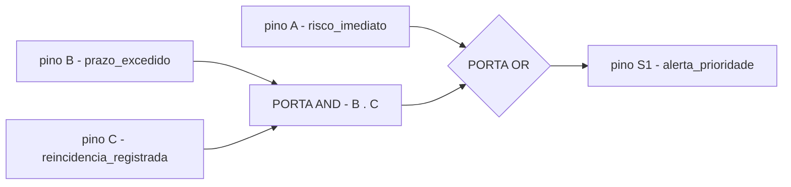
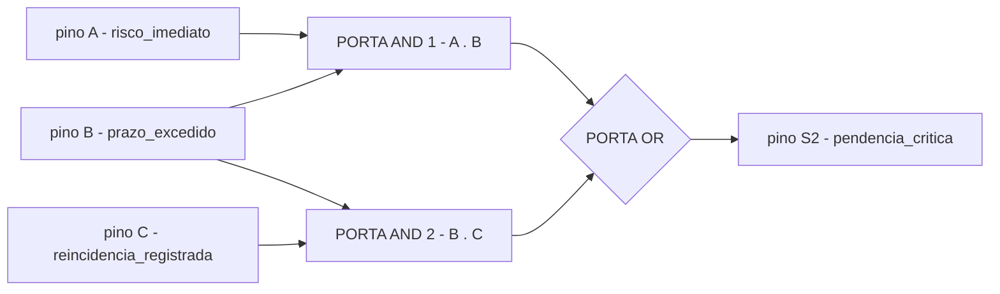

# Neighborhood Action Dashboard — Módulo de Decisão Lógica

**INTEGRANTES DO GRUPO**

Michel de Freitas - RM574206
Eduardo Caffaro - RM574696

---

## Descrição

O **Neighborhood Action Dashboard** é uma plataforma de zeladoria urbana e participação comunitária. Moradores registram ocorrências do bairro — buracos em vias, iluminação pública precária, acúmulo de lixo, risco de alagamento — e a prefeitura precisa decidir **o que atender primeiro**.

O problema central é a triagem: nem toda ocorrência tem a mesma urgência, e uma fila apenas por ordem de chegada pode esconder riscos graves ou problemas que a gestão já deixou vencer. Este projeto entrega um **módulo de decisão lógica** que transforma três sinais objetivos da ocorrência em dois indicadores visuais de prioridade, mantendo o raciocínio totalmente rastreável.

---

## Fluxo

1. A plataforma preenche três entradas booleanas a partir do formulário e do histórico da ocorrência.
2. O módulo lógico avalia as expressões `S1` e `S2` com portas AND e OR.
3. O status visual é definido a partir da combinação de `S1` e `S2`.
4. O dashboard ordena a fila e renderiza métricas e cartões coloridos.

Morador → formulário → A, B, C → modulo_logico.py → S1, S2 → app.py → fila e cartões


---

## ARQUIVOS

`modulo_logico.py` | Portas `AND`/`OR`, expressões de `S1` e `S2`, definição do status visual e função integradora. 
`dados_simulados.py` | Oito ocorrências urbanas realistas, cobrindo as oito combinações binárias. 
`testar_modulo.py` | Validação automática com `assert` das saídas e do status de cada caso. 
`app.py` | Dashboard web em Streamlit: sidebar de simulação, métricas, ordenação e cartões. 
`requirements.txt` | Dependência externa do dashboard. 
`README.md` | Documentação acadêmica e técnica da entrega. 

A lógica de decisão fica isolada em `modulo_logico.py`. O dashboard apenas chama `avaliar_ocorrencia`, o que permite reutilizar o módulo em outra interface sem reescrever as regras.

---

## VVariáveis e sinais

###  Entradas

| `A` | `risco_imediato` | Não há perigo direto a pessoas ou bens. Há exposição imediata a dano. 
| `B` | `prazo_excedido` | O prazo de atendimento ainda está dentro do previsto.  O prazo da tipologia venceu sem conclusão. 
| `C` | `reincidencia_registrada` | É o primeiro registro naquele ponto. A mesma ocorrência já foi registrada no mesmo ponto nos últimos 90 dias. 

### Saídas

 `S1` |`alerta_prioridade` | Cartão sem destaque na fila. Cartão com destaque amarelo. 
 `S2` | `pendencia_critica` | Sem sinalização crítica.  Cartão com destaque vermelho e amarelo. 


A combinação `S1 = 0` e `S2 = 1` não existe no modelo, pois toda pendência crítica também acende o alerta de prioridade.

---

## Regras

1. Uma ocorrência com **risco imediato** recebe alerta de prioridade, independentemente do prazo.
2. Uma ocorrência com **prazo vencido e reincidência** também recebe alerta de prioridade, mesmo sem risco imediato.
3. Uma ocorrência sem risco imediato, dentro do prazo ou vencida sem reincidência, permanece na fila comum.
4. A **pendência crítica** só é marcada quando o prazo venceu **e** existe pelo menos um agravante: risco imediato ou reincidência.
5. Atraso isolado nunca gera cartão vermelho.
6. Toda pendência crítica é também uma prioridade: `S2 = 1` implica `S1 = 1`.
7. Na interface, o vermelho prevalece sobre o amarelo e os dois badges aparecem juntos nos casos críticos.

---

## Expressões booleanas

```
S1 = A + (B · C)
S2 = (A · B) + (B · C)
```

- `S1` combina o risco imediato com o termo `B · C` por meio de uma porta OR.
- `S2` combina os termos `A · B` e `B · C` por meio de uma porta OR, após duas operações AND.

---

## Tabela-verdade completa

| # | `A` | `B` | `C` | `B · C` | `A · B` | `S1` | `S2` | Status visual |
|---|---|---|---|---|---|---|---|---|
| 1 | 0 | 0 | 0 | 0 | 0 | 0 | 0 | Fila Comum |
| 2 | 0 | 0 | 1 | 0 | 0 | 0 | 0 | Fila Comum |
| 3 | 0 | 1 | 0 | 0 | 0 | 0 | 0 | Fila Comum |
| 4 | 0 | 1 | 1 | 1 | 0 | 1 | 1 | Destaque Vermelho + Amarelo |
| 5 | 1 | 0 | 0 | 0 | 0 | 1 | 0 | Destaque Amarelo |
| 6 | 1 | 0 | 1 | 0 | 0 | 1 | 0 | Destaque Amarelo |
| 7 | 1 | 1 | 0 | 0 | 1 | 1 | 1 | Destaque Vermelho + Amarelo |
| 8 | 1 | 1 | 1 | 1 | 1 | 1 | 1 | Destaque Vermelho + Amarelo |

**Conferência da regra `S2 ⇒ S1`:** as únicas linhas com `S2 = 1` são 4, 7 e 8, e todas apresentam `S1 = 1`. Não existe linha com `S2 = 1` e `S1 = 0`.

---

## Circuitos lógicos

### Circuito de `alerta_prioridade` — 1 AND + 1 OR



Ligações:

| Origem | Destino |
|---|---|
| pino `A` | entrada 1 da porta OR |
| pino `B` | entrada 1 da porta AND |
| pino `C` | entrada 2 da porta AND |
| saída da porta AND | entrada 2 da porta OR |
| saída da porta OR | pino `S1` |

### 8.2 Circuito de `pendencia_critica` — 2 AND + 1 OR



Ligações:

| Origem | Destino |
|---|---|
| pino `A` | entrada 1 da AND 1 |
| pino `B` | entrada 2 da AND 1 |
| pino `B` | entrada 1 da AND 2 |
| pino `C` | entrada 2 da AND 2 |
| saída da AND 1 | entrada 1 da porta OR |
| saída da AND 2 | entrada 2 da porta OR |
| saída da porta OR | pino `S2` |


## Interface do dashboard

Rode o arquivo `app.py` implementa o painel em Streamlit.


## 10. Casos de teste simulados

Os oito casos de `dados_simulados.py` cobrem exatamente as combinações `000` a `111`. O script `testar_modulo.py` compara `S1`, `S2` e o status com `assert`, além de conferir a quantidade de casos e a cobertura completa.

| ID | Ocorrência | `A` | `B` | `C` | `S1` | `S2` | Status visual | Teste |
|---|---|---|---|---|---|---|---|---|
| `OC-001` | Lixeira com tampa quebrada | 0 | 0 | 0 | 0 | 0 | Fila Comum | Conforme |
| `OC-002` | Buraco pequeno na calcada | 0 | 0 | 1 | 0 | 0 | Fila Comum | Conforme |
| `OC-003` | Poste com lampada apagada | 0 | 1 | 0 | 0 | 0 | Fila Comum | Conforme |
| `OC-004` | Descarte irregular de moveis | 0 | 1 | 1 | 1 | 1 | Destaque Vermelho + Amarelo | Conforme |
| `OC-005` | Buraco profundo na via principal | 1 | 0 | 0 | 1 | 0 | Destaque Amarelo | Conforme |
| `OC-006` | Fiacao exposta em poste | 1 | 0 | 1 | 1 | 0 | Destaque Amarelo | Conforme |
| `OC-007` | Tampa de bueiro aberta | 1 | 1 | 0 | 1 | 1 | Destaque Vermelho + Amarelo | Conforme |
| `OC-008` | Risco de alagamento com bueiro entupido | 1 | 1 | 1 | 1 | 1 | Destaque Vermelho + Amarelo | Conforme |

Resultado da execução: **8 de 8 casos conformes**, cobrindo `000` a `111`.

```text
Casos validados: 8
Cobertura: 000 a 111
Todos os testes passaram.
```

---

